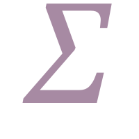
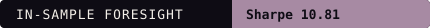
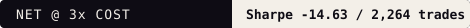
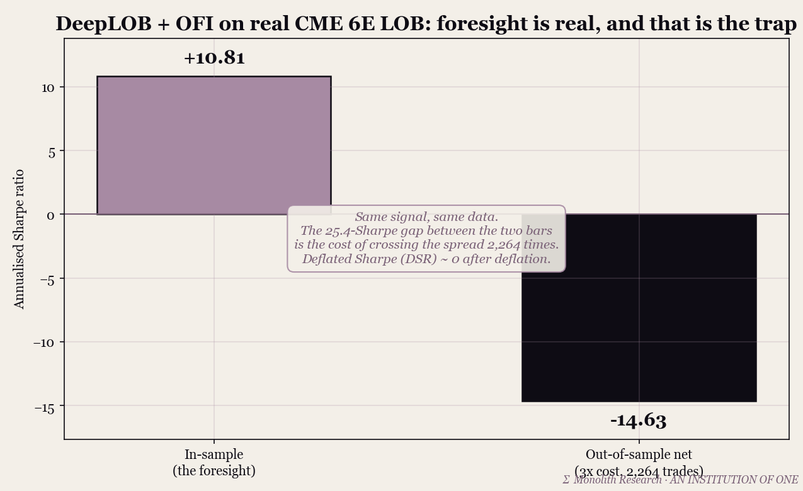

<div align="center">



# DeepLOB + Order-Flow Imbalance

**A deep order-book model that predicts the next tick beautifully — and loses money anyway.**

A worked case study in why foresight isn't a tradeable edge.





</div>

---

This is a real DeepLOB — deep CNN + LSTM on the limit order book, after Zhang–Zohren–Roberts (2018) — plus a multi-level order-flow-imbalance pipeline (Cont–Kukanov–Stoikov 2014), trained on genuine Databento `mbp-10` data for CME 6E (EUR futures).

In-sample it looks unreal: **Sharpe 10.81**. That's the trap. Net of realistic 3× costs, the same signal on the same data returns **Sharpe −14.63 over 2,264 out-of-sample trades**, with a Deflated Sharpe ≈ 0. The 25-Sharpe gap between those two numbers is the price of crossing the spread. The model genuinely *sees* short-horizon direction. It can't *trade* it.

I built this to make that distinction undeniable — and kept the honest, no-lookahead out-of-sample test that exposes it. It runs end to end on a small synthetic order-book generator, so you can reproduce the lesson with no licensed data.

> No raw Databento / WRDS / broker data, no live-execution code, no credentials. Methodology and summary statistics only.

## The result

<div align="center">

</div>

| | In-sample (foresight) | Out-of-sample net (3× cost) |
|---|---:|---:|
| Sharpe | **+10.81** | **−14.63** |
| Trades | — | **2,264** |
| Deflated Sharpe | — | **≈ 0** |

**Why it dies** (full detail in [`docs/RESULTS.md`](docs/RESULTS.md)):

1. **A perfect predictor still can't pay the spread.** The gross edge of a *perfect* call on the real book is ~0.22 bp at 5s and ~0.84 bp at 1 min — both under even a 1× round trip (~1.4 bp).
2. **OFI is contemporaneous, not predictive.** `corr(ofi_z, same-bar) = +0.860` but `corr(ofi_z, next-bar) = +0.0022`. It's a same-instant liquidity effect, gone by the next bar.
3. **Latency kills the residue.** One bar of execution delay removes ~96% of what little is left.

The flow predictability that genuinely exists (Diebold–Mariano |z| up to ~5.3 on the real book) is worth maybe ~0.19 bp/trade — orders of magnitude under the cost bar. Not weak evidence of an edge; a clean, powered negative.

## Run it (no licensed data needed)

```bash
pip install -r requirements.txt

# synthetic LOB -> 40-channel features -> labels -> train one DeepLOB fold
#   -> HONEST no-lookahead OOS backtest -> Monolith-branded equity chart
py -3.14 demo/run_demo.py

# faster: skip training, just the OFI honest backtest
py -3.14 demo/run_demo.py --no-train
```

```
[OOS] net_Sharpe=0.0000  trades=15,143
      avg_gross_bp=0.0030  vs  avg_cost_bp=0.8939   gross>cost = False  => FAIL
```

<div align="center">

</div>

```bash
py -3.14 -m pytest tests/ -q      # 13 tests: features, model, signal gate, honest OOS
```

## The no-lookahead contract (taken seriously)

- Per-level OFI at bar *t* uses snapshots *t−1* and *t* only; smoothing and z-score windows are causal (right-aligned rolling).
- A position decided at *t* from features ≤ *t* is filled at `mid[t]`, held *H* bars, exited at `mid[t+H]`. Forward P&L is **masked** whenever the interval crosses a time gap — no synthetic overnight/weekend P&L.
- Cost is the **real** top-of-book half-spread at entry *and* exit (you cross both ways) plus a fixed commission, per round trip.
- Holds are **non-overlapping**, so trades are independent and the Sharpe isn't overlap-inflated.

## About

**Monolith Research** is my quant startup. I'm **Bilal Malik** — Lancaster Finance (first-year: First Class), IMC Prosperity **top 15 of ~2,200**, IBT high distinction, multilingual. I build the whole stack — PyTorch microstructure models, numba-vectorised cross-sectional engines, survivorship-correct point-in-time equity panels, live MT5 + PythonAnywhere ops.

The thread across my portfolio is a refusal to confuse a backtest with an edge. This is one worked example: a model that does exactly what it promises, and the discipline that proves it still shouldn't be traded.

Part of my portfolio → **[github.com/05bilalmalik-cmd](https://github.com/05bilalmalik-cmd)**

<div align="center">


**Σ Monolith Research — Evidence over narrative**

MIT Licensed · © 2026 Bilal Malik / Monolith Research

</div>
