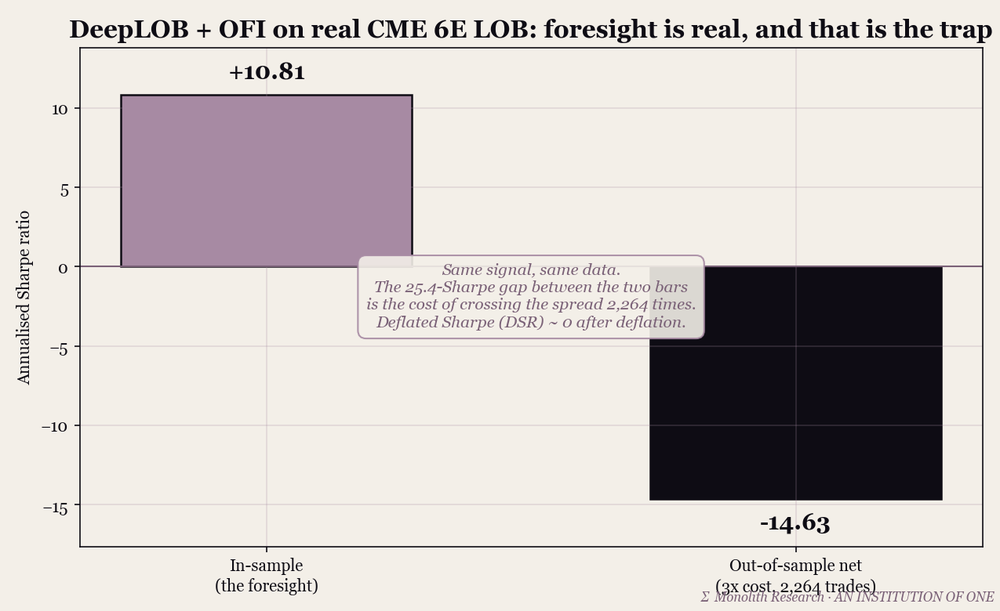

# Results — the honest record

> **Σ Monolith Research · Evidence over narrative**
>
> Palette: Ink `#0E0C14` · Plum `#A78AA3` · Paper `#F3EFE8`

This file states the full out-of-sample results, including — especially — where
the strategy fails. Nothing here is truncated to flatter the curve. The failure
is the finding.

---

## 1. The headline (real CME 6E data)

The DeepLOB + OFI signal was researched on **genuine Databento `mbp-10`
(10-level) limit-order-book snapshots for CME 6E (EUR futures)**, resampled to a
regular 5-second grid.

| Metric | Value |
|---|---|
| In-sample Sharpe (the foresight) | **10.81** |
| Net Sharpe at 3× realistic cost | **−14.63** |
| Trades (out-of-sample) | **2,264** |
| Deflated Sharpe Ratio (DSR) | **≈ 0** |



A 25.4-Sharpe gap separates the two bars. That gap is not a bug in the model —
it is the cost of crossing the bid–ask spread 2,264 times. The model genuinely
*sees* short-horizon direction. It cannot *trade* it.

**Foresight is real, and that is the trap.**

---

## 2. Why the edge dies — three structural facts

A separate, pre-registered viability/kill test (40 declared trial cells: 2
datasets × 2 probes × 5 horizons × 2 triggers, run once) reproduced the same
conclusion and isolated *why*:

1. **A perfect predictor cannot pay the spread at short horizons.** The
   foresight ceiling — the gross edge of a *perfect* predictor — on the real
   book is roughly: H=1 bar (5s) ≈ 0.22 bp, H=12 (1 min) ≈ 0.84 bp, H=60 (5 min)
   ≈ 1.91 bp, H=180 (15 min) ≈ 3.29 bp, H=720 (1 hr) ≈ 6.60 bp. The 1× retail
   round-trip cost alone (~1.4 bp) exceeds the *perfect-predictor* ceiling for
   every horizon ≤ 1 minute. The 3× cost bar (4.2 bp) is only above water at
   H=720 — a horizon at which the OFI information is empirically dead.

2. **OFI is contemporaneous, not predictive, at 5s.** On the training slice,
   `corr(ofi_z, same-bar return) = +0.860` but `corr(ofi_z, next-bar return) =
   +0.0022`. The canonical OFI/price relationship is a same-instant liquidity
   effect that has fully dissipated by the next 5-second bar. There is nothing
   left for a 5s-bar trader to harvest.

3. **Latency destroys what little remains.** A single-bar (5–10s) execution
   delay removes ~96% of the residual edge at the shortest horizon.

The genuine, statistically significant flow predictability that *does* exist
(Diebold–Mariano |z| up to ~5.3 on the real book) is worth at most ~0.19 bp per
trade where it is significant — two to three orders of magnitude below the cost
bar.

---

## 3. The validation gate

The firm-wide validation framework was applied with the default gate:

```
GATE = DSR >= 0.50  AND  PBO <= 0.20  AND  trades >= 50
```

Every declared cell **FAILS** (DSR = 0.0000 across the board; net 3× Sharpes
ranged roughly −4 to −41 depending on horizon and trigger). The trial count was
declared *before* the run, all cells were computed and reported, and the DSR was
deflated by the full trial count. Nothing was selected post-hoc.

---

## 4. The synthetic demo (this repo)

The runnable demo (`demo/run_demo.py`) cannot use the licensed Databento data, so
it generates a small synthetic LOB. With the default settings (a driftless
random-walk mid — the honest null), the in-sample sweep still manufactures an
"edge", and the out-of-sample slice plus the spread destroy it:

```
[freeze] depth=1 smooth=1 zwin=120 horizon=1 thr=0.5  IS_trades=28,117
[OOS]    net_Sharpe=0.0000  trades=15,143
         avg_gross_bp=0.0030  vs  avg_cost_bp=0.8939   gross>cost = False  => FAIL
```


The synthetic numbers are illustrative only — they are not a model of any real
market. They exist to show the machinery end-to-end and to reproduce the
qualitative lesson. The authoritative numbers are the real-data figures in §1.

---

## 5. References

- Zhang, Zohren & Roberts (2018), *DeepLOB: Deep Convolutional Neural Networks
  for Limit Order Books*, arXiv:1808.03668.
- Cont, Kukanov & Stoikov (2014), *The Price Impact of Order Book Events*,
  Journal of Financial Econometrics 12(1), 47–88.
- Bailey & López de Prado, *The Probabilistic Sharpe Ratio* (SSRN 1821643),
  *The Deflated Sharpe Ratio* (SSRN 2460551), and *The Probability of Backtest
  Overfitting / CSCV* (SSRN 2326253).
